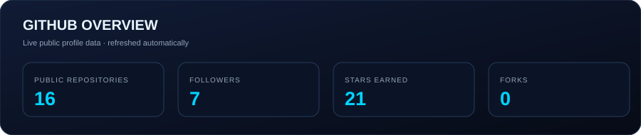
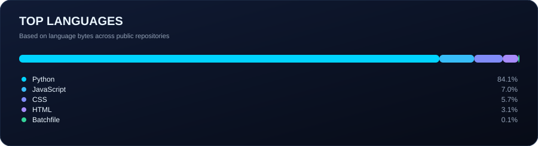
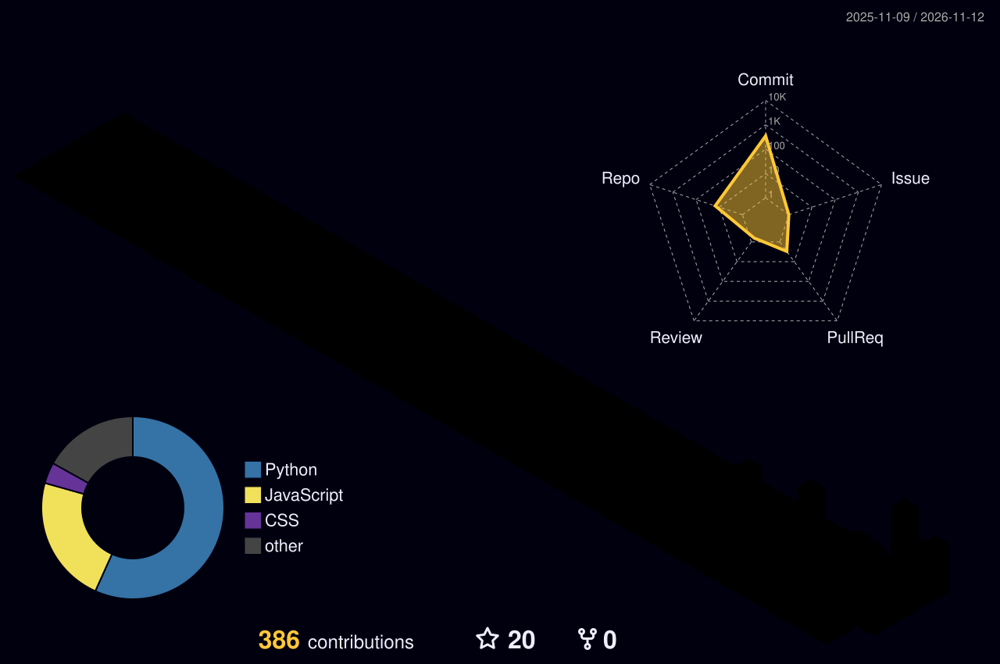

<!--
  GitHub Profile README
  Author: Joshua Arao
  Theme: Dark / Futuristic
-->

  

  

   

  
  
  

---

## 

Hi! I'm **Joshua Arao**, a Computer Science student who enjoys building practical software, exploring new technologies, and turning ideas into working applications.

I’m interested in:
- Python development and desktop applications
- Web development and useful digital tools
- Problem-solving, automation, and software design
- Learning through building and improving real projects

~~~python
class Developer:
    name = "Joshua Arao"
    role = "Computer Science Student"
    interests = ["Python", "Software Development", "Problem Solving"]
    mindset = "Build • Learn • Improve"
~~~

## 

  

## 

  <table>
    <tr>
      <td width="33%" valign="top">
        <h3 align="center">KODIGO</h3>
        

          
        

        
A customizable QR code studio for generating, personalizing, previewing, and exporting QR codes.

        
<a href="https://github.com/joshuaarao42-arch/KODIGO"><strong>Explore repository →</strong></a>

      </td>
      <td width="33%" valign="top">
        <h3 align="center">HULAGWAY</h3>
        

          
        

        
A desktop image toolkit for compression, format conversion, resizing, batch processing, and image inspection.

        
<a href="https://github.com/joshuaarao42-arch/HULAGWAY"><strong>Explore repository →</strong></a>

      </td>
      <td width="33%" valign="top">
        <h3 align="center">KONSUMO</h3>
        

          
        

        
A household utility monitoring dashboard for tracking electricity and water usage, costs, and consumption insights.

        
<a href="https://github.com/joshuaarao42-arch/KONSUMO"><strong>Explore repository →</strong></a>

      </td>
    </tr>
  </table>

## 

  

   

  

## 

  

---

  **Thanks for stopping by!**

  Hinay-hinay pero kanunay

  

